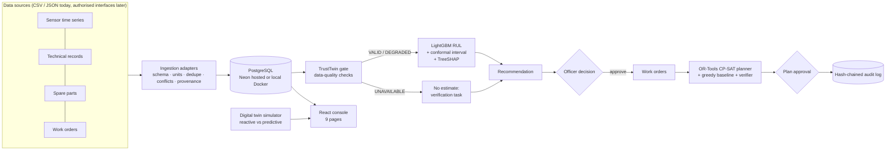

# AeroPulse AI

**Predict Early. Maintain Smarter. Fly Ready.**

An explainable, confidence-aware predictive-maintenance and fleet-availability **decision-support** prototype for
Smart India Hackathon 2026 problem **SIH26249 — Air Power: Predictive Maintenance & Fleet Availability**
(Ministry of Defence / Defence Services Staff College).

> **Read this first.** AeroPulse AI produces *advisory* maintenance intelligence only. It never authorises flight,
> dispatch or airworthiness. It has **not** been validated on military aircraft. The ML model is trained on NASA's
> public C-MAPSS data (simulated *commercial* turbofans); the fleet, people, parts, work orders and records are
> **synthetic** and labelled as such everywhere in the product.

---

## Why it is different — AeroPulse TrustTwin

Most predictive-maintenance demos show a remaining-useful-life (RUL) number. AeroPulse answers the harder question:

> *Can we trust this prediction, and what is the safest feasible maintenance response given the resources we actually have?*

| Capability | What it actually does (implemented) |
|---|---|
| Sensor reliability checks | Missing fields, non-numeric/implausible values, Kelvin-vs-Rankine unit hints, step deviations, stale data, short history, training-distribution (OOD) check |
| Confidence gating | `VALID` → advisory use · `DEGRADED` → manual verification · `UNAVAILABLE` → **no RUL is produced** |
| Calibrated uncertainty | Mondrian split-conformal 90 % intervals, coverage **measured** on unseen engines |
| Explanations | Exact TreeSHAP contributions per prediction (verified identical to `shap.TreeExplainer`) |
| What-if twin | Replays further *recorded* degradation, sensor dropout/bias/noise, staleness, part outages, technician absences, simultaneous inspections → re-assesses with the real model → re-plans with OR-Tools → diffs baseline vs revised → computes engine risk margins |
| Human in the loop | Prediction, Recommendation, Decision and Work order are separate entities; officers approve/reject with reasons; every action is in a hash-chained audit log |

## Problem alignment

| SIH26249 need | Where it lives |
|---|---|
| Integrate fragmented data (health monitoring, technical records, spares, agencies) | CSV/JSON adapters for sensors, maintenance records, parts, work orders with schema/units validation, idempotent imports, conflict rejection, provenance ([integration guide](docs/integration-guide.md)) |
| Early fault prediction | LightGBM RUL model on NASA C-MAPSS FD001 ([model training](docs/model-training.md)) |
| Explainable health assessment | TrustTwin checks + TreeSHAP evidence on the Aircraft Health page |
| Maintenance planning & resource optimisation | OR-Tools CP-SAT planner with skills, shifts, leave, parts stock + arrivals, precedence, aircraft conflicts, approval lead time |
| Fleet readiness visibility | Command overview, fleet table, simulated availability trends |
| Scenario-based evaluation | TrustTwin what-if scenarios + reactive-vs-predictive digital twin |
| Accountability | Role-based approvals, decisions with reasons, tamper-evident audit chain, CSV exports |
| Path to deployment | Docker, self-hosted PostgreSQL (offline) or Neon, OIDC path, [roadmap](#pilot-implementation-roadmap) |

## Architecture



More diagrams (ML pipeline, TrustTwin flow, optimisation, data integration): [docs/architecture.md](docs/architecture.md).

| Layer | Stack |
|---|---|
| ML | Python 3.11, pandas, NumPy, scikit-learn, LightGBM, SHAP (training), joblib |
| Backend | FastAPI, Pydantic, SQLAlchemy 2, Alembic, psycopg 3, OR-Tools CP-SAT, bcrypt + JWT |
| Database | **Neon PostgreSQL** (hosted) · PostgreSQL 16 in Docker (offline/on-prem) · SQLite (tests only) |
| Frontend | React 19, TypeScript, Vite, Tailwind CSS v4, TanStack Query, React Router, Recharts, lucide-react, self-hosted IBM Plex |
| Deployment | Docker Compose (postgres + backend + nginx frontend) |

## Measured results (real, reproducible)

Dataset: NASA C-MAPSS FD001 from the official NASA PCoE S3 archive (sha256 `c9c5dec1…ad3b2`).
Protocol: engines split by unit (65 fit / 15 conformal calibration / 20 hold-out); model selection by engine-grouped
5-fold CV; final test on the official `test_FD001` (last observed cycle of each of 100 engines) vs `RUL_FD001`.

| Official test set (100 engines) | RMSE | MAE | PHM08 score |
|---|---|---|---|
| **LightGBM (selected)** | **15.74** | **11.51** | **432** |
| Ridge regression baseline | 21.47 | 17.04 | 1084 |
| Mean-RUL baseline | 43.01 | 35.90 | 32901 |

* 90 % conformal interval coverage: **0.89** on the test set (vs RUL capped at 125 — the training target), 0.82 vs raw
  truth; **0.899** on the 20 hold-out engines (all cycles), 0.964 when true RUL ≤ 50. Mean interval width 43.5 cycles.
* Hold-out engines: RMSE 14.70 overall, **8.23 when true RUL ≤ 50** cycles.
* Engine-grouped CV RMSE: LightGBM 14.91 · Ridge 20.73 · mean 41.69.

Simulated digital twin, default settings, seed 2026 (120 days, 10 aircraft × 2 engines) —
*Results from a simulated scenario, not demonstrated real-world fleet improvements:*

| Metric | A · reactive | B · predictive (TrustTwin-gated, reviewed) |
|---|---|---|
| Unscheduled engine failures | 20 | **0** |
| Simulated availability | 92.0 % | 92.2 % |
| Planned replacements / verification inspections | 0 / 0 | 28 / 36 |
| Remaining life removed early | 0 | 1,403 cycles |

Honest reading: in this synthetic setting predictive planning removes unscheduled failures but does **not** raise
availability, because conservative early replacements and inspections consume spares and crew time. See
[docs/evaluation.md](docs/evaluation.md).

## Quick start (local development)

Prerequisites: Python 3.11, Node 20+, (optional) Docker Desktop.

```bash
git clone https://github.com/sahilkarande0918-cmd/AeroPulse-AI.git
cd AeroPulse-AI
cp .env.example .env            # then set JWT_SECRET_KEY and DEMO_PASSWORD
python -m venv .venv
.venv/Scripts/python -m pip install -r requirements-dev.txt     # Linux/macOS: .venv/bin/python
```

Optional — retrain the model from the NASA archive (downloads ~12 MB, ~20 s on CPU; trained artifacts are already committed):

```bash
.venv/Scripts/python manage.py train
```

Create the database, seed the synthetic fleet, start the API:

```bash
.venv/Scripts/python manage.py migrate
.venv/Scripts/python manage.py seed
.venv/Scripts/python manage.py serve
```

Start the frontend (second terminal):

```bash
npm --prefix frontend install
npm --prefix frontend run dev
```

Open http://localhost:5173 and sign in as `officer` (or `admin`, `technician`, `analyst`) with your `DEMO_PASSWORD`.
API docs (OpenAPI): http://localhost:8000/docs.

## Docker

```bash
# Offline / on-premise / live demos: bundled PostgreSQL 16, no network latency (ignores DATABASE_URL)
docker compose -f docker-compose.yml -f docker-compose.local.yml up -d --build
# Hosted Neon PostgreSQL: put your Neon DATABASE_URL in .env, then
docker compose up -d --build
```

Console: http://localhost:8080. Details, backups and migrations: [docs/deployment.md](docs/deployment.md).

## Environment variables

| Variable | Purpose |
|---|---|
| `DATABASE_URL` | Neon connection string (`postgresql://…?sslmode=require`), or local PostgreSQL; unset = SQLite dev file |
| `JWT_SECRET_KEY` | Token signing secret (required when `APP_ENV=production`) |
| `DEMO_PASSWORD` | Password for the four seeded demo users |
| `POSTGRES_PASSWORD` | Password for the Docker PostgreSQL service |
| `APP_ENV` | `development` or `production` |
| `CORS_ORIGINS` | Comma-separated allowed browser origins |
| `LLM_ENABLED`, `GEMINI_API_KEY`, `GEMINI_MODEL` | Optional explainer; **off by default**, core platform never needs it |
| `MODEL_PATH`, `DATA_DIRECTORY`, `LOG_LEVEL`, `JWT_EXPIRE_MINUTES`, `MAX_UPLOAD_BYTES` | Optional overrides |

## Tests

```bash
.venv/Scripts/python -m pytest -q          # 65 tests: ML, TrustTwin, planner, RBAC, approvals, simulation, ingestion, persistence
.venv/Scripts/ruff check .
npm --prefix frontend test                 # Vitest: API error handling, withheld-prediction UI
npm --prefix frontend run build            # tsc + production build
npm --prefix frontend run check:secrets    # fails if any server secret appears in the bundle
```

End-to-end smoke against a running stack: `python scripts/smoke.py http://localhost:8080` (Docker) or `http://localhost:5173` (dev).

Mapping of the 18 mandatory test scenarios to test functions: [docs/evaluation.md#test-coverage](docs/evaluation.md#test-coverage).

## The nine pages

Command overview · Aircraft fleet · Aircraft health detail · Predictive intelligence · Maintenance planner (Gantt) ·
Spare parts · **AeroPulse TrustTwin** (scenario workspace + digital-twin policy comparison) · Reports & audit ·
Settings & data connections. Demo script: [docs/demo-guide.md](docs/demo-guide.md).

## Security assumptions

Development-stage security, **not** accredited for classified use: bcrypt passwords, JWT, backend-enforced roles
(admin, maintenance officer, technician, read-only analyst), restrictive CORS, validated uploads (type + 5 MB cap,
never written to disk), parameterised SQL via SQLAlchemy, login rate limiting, CSP and security headers in nginx,
secrets only via environment, no runtime cloud dependency. See [docs/security.md](docs/security.md).

## Known limitations

C-MAPSS is simulated commercial-engine data with a single operating condition and fault mode (FD001); real fleets
differ in sensors, units, operating regimes and failure modes. Thresholds, actions and part numbers are prototype
placeholders. Interval coverage assumes in-distribution data. The simulator is deliberately simple. Full list:
[docs/limitations.md](docs/limitations.md).

## Pilot implementation roadmap

1. **Prototype (this repository)** — public NASA data + synthetic integration.
2. **Authorised pilot data** — non-classified, representative equipment data through approved interfaces; adapt `mapping_v1.json`.
3. **Independent validation** — data mappings, model accuracy on the target fleet, interval coverage, failure modes, workflows.
4. **Security & operations** — accredited review, on-prem deployment, OIDC/SSO, backup/restore drills, reliability tests.
5. **Supervised pilot** — approved maintainers, defined success criteria, model outputs shadowing existing practice.
6. **Assurance & scale-up** — only after organisational acceptance.

Real maintenance procedures, thresholds and authority must come from approved domain experts and regulations. No
system-level readiness improvement can be claimed from C-MAPSS evaluation alone.

## Data provenance & licences

NASA C-MAPSS: A. Saxena, K. Goebel, D. Simon, N. Eklund, "Damage Propagation Modeling for Aircraft Engine
Run-to-Failure Simulation", PHM 2008; NASA Prognostics Center of Excellence Data Set Repository. Third-party
components: [THIRD_PARTY_NOTICES.md](THIRD_PARTY_NOTICES.md).
