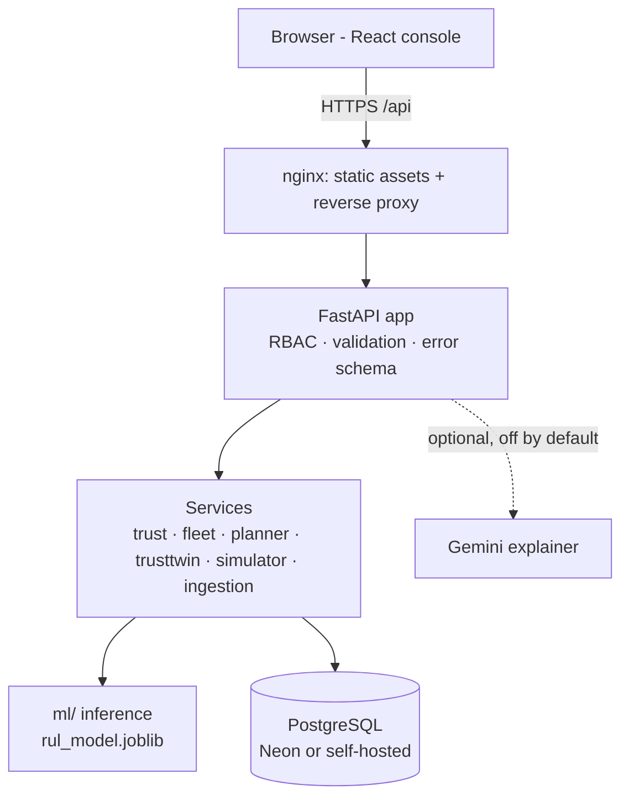
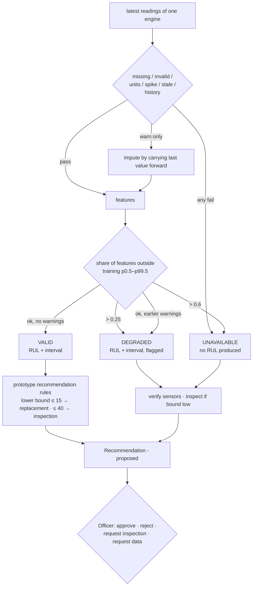
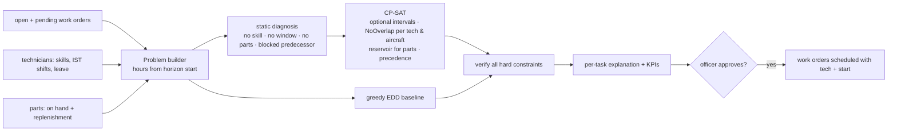
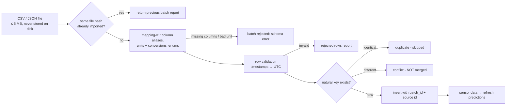

# Architecture

AeroPulse AI is a **modular monolith**: one FastAPI process, one PostgreSQL database, one static React bundle.
Module boundaries are explicit so a later split is possible, but nothing requires it today.

| Module | Code | Responsibility |
|---|---|---|
| Data ingestion | `backend/app/services/ingestion.py`, `backend/app/mappings/mapping_v1.json` | Adapters for 4 source types, validation, provenance |
| Prediction & explanation | `ml/features.py`, `ml/inference.py` | Causal features, LightGBM RUL, conformal interval, TreeSHAP |
| Trust assessment | `backend/app/services/trust.py` | Data-quality checks and VALID / DEGRADED / UNAVAILABLE gate |
| Recommendations & glue | `backend/app/services/fleet.py` | Prediction → recommendation → work order; builds planning problems |
| Maintenance scheduling | `backend/app/services/planner.py` | CP-SAT optimiser, greedy baseline, independent constraint verifier |
| What-if & simulation | `backend/app/services/trusttwin.py`, `backend/app/services/simulator.py` | Sandboxed scenarios; reactive vs predictive digital twin |
| Persistence & audit | `backend/app/models.py`, `backend/app/security.py`, `backend/alembic/` | SQLAlchemy models, migrations, RBAC, hash-chained audit |
| Web presentation | `backend/app/api/*`, `frontend/src/*` | REST API (OpenAPI at `/docs`) and the React console |

## 1. Overall system

## 2. ML training and inference pipeline

```mermaid
flowchart LR
  zip[NASA archive\nsha256 verified] --> parse[parse train/test/RUL\nschema checks]
  parse --> split[split by engine\n65 fit · 15 calib · 20 hold-out]
  split --> sel[sensor selection\non fit engines only]
  sel --> feat[causal rolling features\nmean/std 10 · slope 20]
  feat --> cv[GroupKFold CV\nmean · ridge · 2 LightGBM]
  cv --> fit[refit best on fit engines]
  fit --> conf[Mondrian conformal\non calibration engines]
  conf --> eval[test_FD001 + hold-out evaluation\nSHAP check · plots · report]
  eval --> art[(artifacts:\nmodel · schema · report)]
  art --> inf[runtime: same build_features\n→ predict → interval → pred_contrib]
```

## 3. TrustTwin decision flow

## 4. Maintenance optimisation workflow

Objective (weights configurable per request): Σ priority_weight × (lateness_w × hours late + unscheduled_w ×
[unscheduled] + completion_w × finish hour), priority weights P1..P4 = 8, 4, 2, 1. Solver runs single-worker with a
fixed seed so identical inputs give identical plans. Each plan stores the SHA-256 of its input problem.

## 5. Data integration architecture

## Key data entities

`Aircraft`, `Engine` (with C-MAPSS source unit), `SensorReading` (JSON values; missing keys = missing data),
`Prediction` (state, RUL, interval, checks, evidence, model version), `Recommendation`, `Decision`, `WorkOrder`,
`Technician`, `Part`, `MaintenanceRecord`, `Schedule` (stored result + input hash), `ScenarioRun` (params, result,
result hash), `IngestionBatch`, `AuditEvent` (prev_hash, hash), `AppSetting` (trust thresholds).
